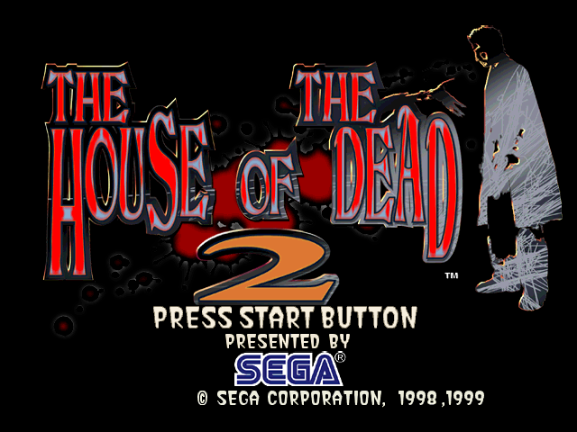
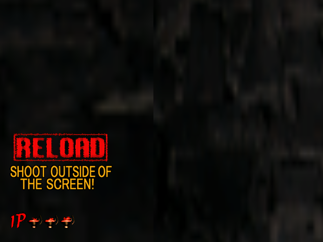
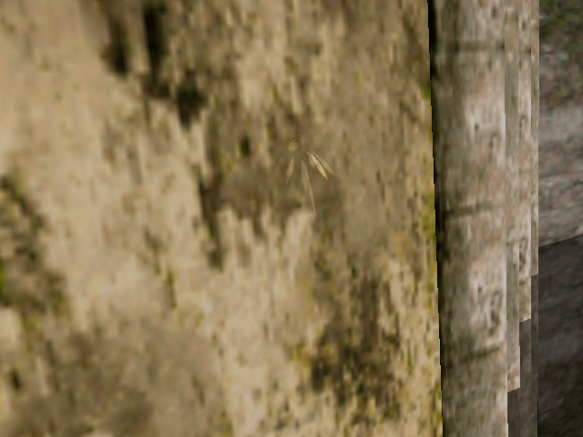
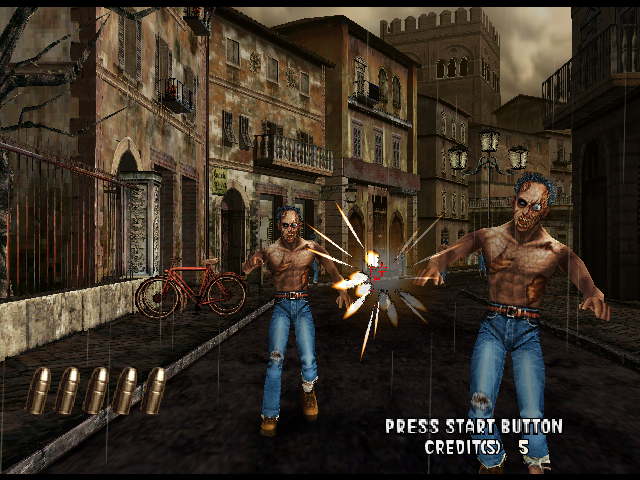

# The House of the Dead 2 (PC) — Static Recompilation

Static recompilation of **The House of the Dead 2** (SEGA, PC release 2001)
from its shipping Win32 executable, `Hod2.exe`, to native C. Its 4,832
functions are lifted to C, compiled with MSVC, and run on pcrecomp's
`native32` host, which calls the real DirectDraw, Direct3D, DirectInput and
DirectSound. It runs SEGA's own code; it is not a remake, an emulator or a
wrapper DLL.

Built on the [pcrecomp](https://github.com/sp00nznet/pcrecomp) toolchain, on
its **`pcrecomp-stp`** branch: the guest registry, synthetic DirectInput and
DirectDraw fixes this game plays on are not on pcrecomp `main` yet. The first
game is a separate project: [hotd-recomp](https://github.com/sp00nznet/hotd-recomp).

## Getting Started

You need **your own copy of The House of the Dead 2 (PC)**: the US CD, an
`.iso` or `.cue`/`.bin` of it, or a folder copy of it. Nothing from the game
is in this repository or downloaded for you, and the generated C is not
distributed: everything is built on your machine from your copy. The CD
check passes with your disc in the drive or your disc image mounted.

### The setup scripts

1. Download this repository (the green **Code** button, then **Download ZIP**)
   and unzip it somewhere with 2 GB free.
2. Double-click **`Setup.cmd`** (Windows only; see Status).
3. Play with the **`The House of the Dead 2`** shortcut in that folder.

The script asks before installing anything (Python 3.10+, `pefile` and
`capstone`, git, the Visual Studio 2022 C++ tools), clones pcrecomp beside
this folder on its `pcrecomp-stp` branch (or offers to switch an existing
clone to it), finds the CD in your drives or asks for a drive, folder, `.iso`
or `.cue`, copies the installed game into `game\` (unpacking the CD's `.msi`),
then catalogs, lifts and builds. A rerun skips finished steps; if it stops it
says why, and the details are in `setup.log`. `-GameDir E:\` skips the
question and `-Yes` answers yes to every install.

There is no installer release yet. Building by hand, the command line and
scripted runs are in **[docs/building.md](docs/building.md)**.

The game reaches the title and the attract demo. Playing it by hand doesn't
work yet: stage 1 has only been played by scripted input (`--key`, `--click`).

## Status

**v0.1.0, early alpha.** It boots to the title and the attract demo, and a
scripted run plays stage 1 (Start, then shooting and reloading) to the first
zombies and on to a Continue. Live mouse and keyboard input doesn't work yet.

| | |
|---|---|
| Version recompiled | `Hod2.exe` as installed from the US CD (Activision Value), PE stamp `0x3B173404`; `run_lift.py` refuses any other build |
| Lift | 4,832 functions, 0 errors |
| Boot: CD check, D3DX device, SEGA logo, title, attract demo | ✅ |
| Playing stage 1 by scripted input | ✅ |
| Playing by hand (live mouse, keyboard) | not yet: DirectInput doesn't acquire the real devices windowed |
| Window | 640x480 windowed; `--fullscreen` is the original's. The host relaunches itself under Windows' 16-bit color compatibility layers |
| Activision intro movie | skipped: it is Indeo 3.2, which Windows no longer has |
| Sound | DirectSound; not yet checked by ear |
| Light gun, two players | not yet |
| `Setup.cmd` | run end to end from a fresh clone with the Redump `.cue`/`.bin` of the US CD |
| Linux, macOS | no: `native32` is Windows-only, and Wine is untested. `setup.sh` says so and exits |
| Headless | `--headless` (see-through window, `--shot` still works); `--record` not yet |
| Conformance harness | not yet |

[docs/lifting.md](docs/lifting.md) is the log of each wall and its fix, and
[ROADMAP.md](ROADMAP.md) what comes next.

## Screenshots

Real output of `build\hotd2recomp.exe --run --shot`, recompiled code throughout:

| | |
|---|---|
|  |  |
| The attract demo's HUD | Stage 1 in the attract demo |
|  | |
| Stage 1, played (scripted clicks) | |

## Documentation

- [docs/building.md](docs/building.md): building by hand, the command line, scripted runs, netlab
- [docs/architecture.md](docs/architecture.md): how the pieces fit
- [docs/lifting.md](docs/lifting.md): every wall so far and its fix
- [ROADMAP.md](ROADMAP.md), [CHANGELOG.md](CHANGELOG.md), [CONTRIBUTING.md](CONTRIBUTING.md)

## Contributors

See **[CONTRIBUTORS.md](CONTRIBUTORS.md)**.

## License

MIT for this repository's own code ([LICENSE](LICENSE)). The House of the
Dead 2 is © SEGA; none of its files, and nothing generated from them, is in
this repository ([NOTICE.md](NOTICE.md)).
